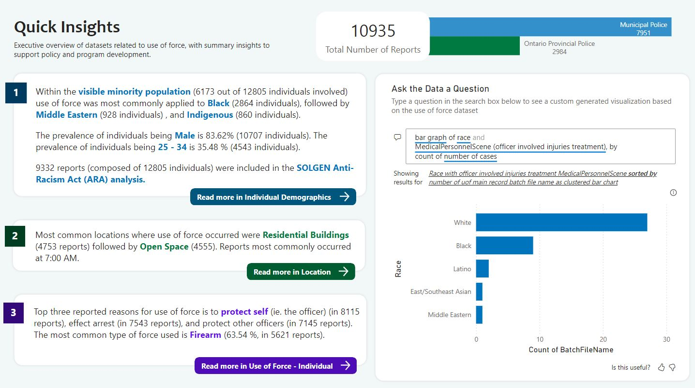
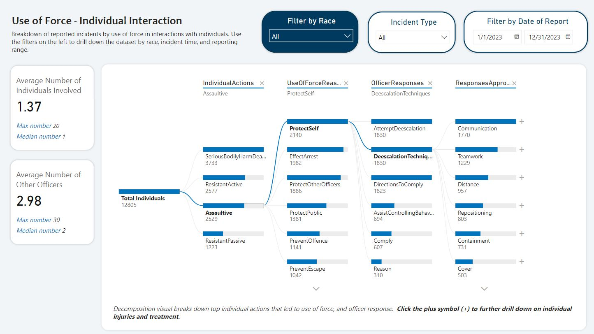
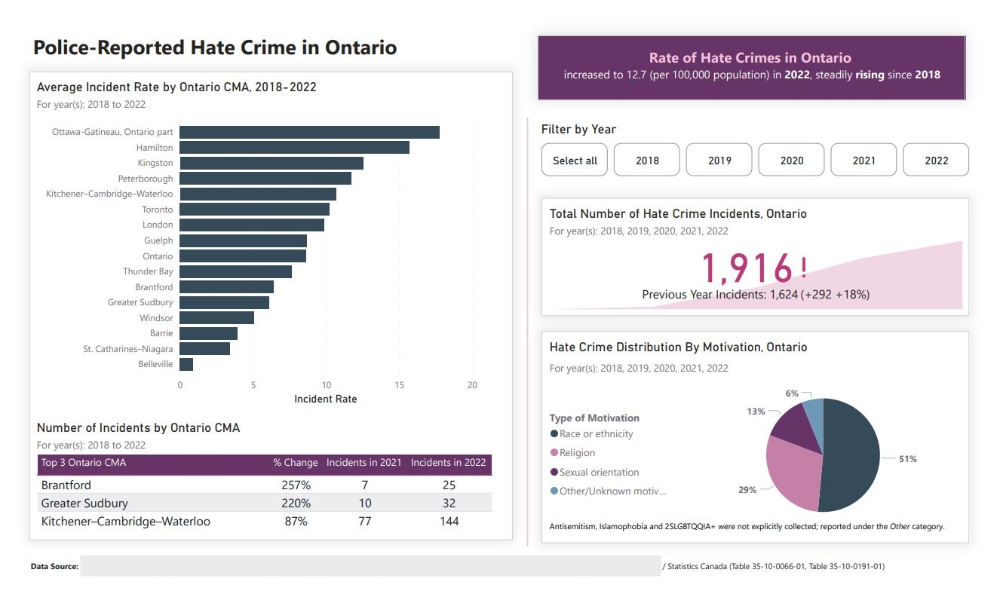
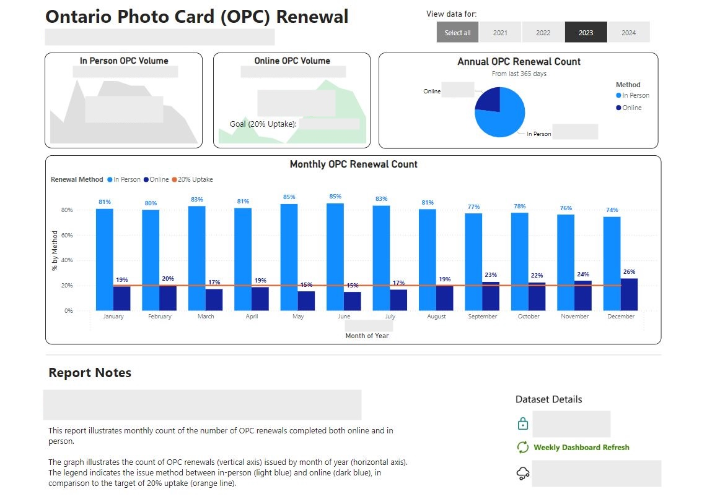
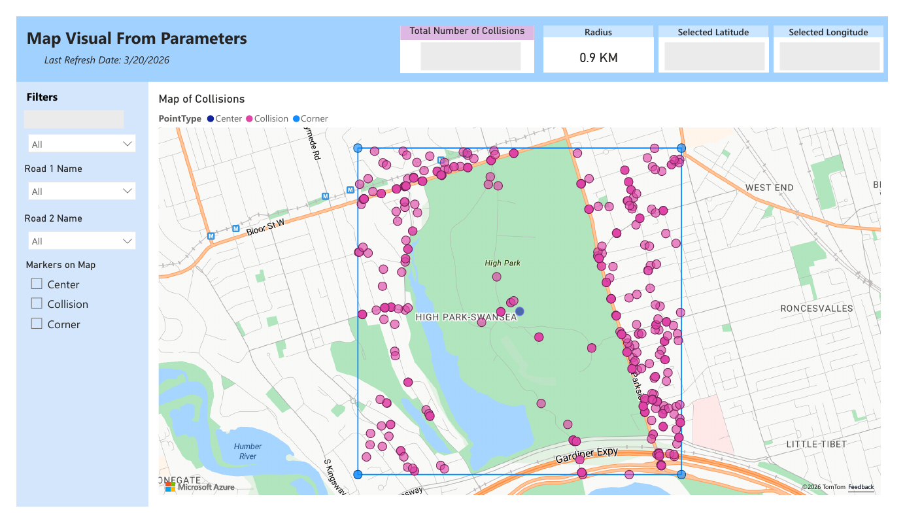
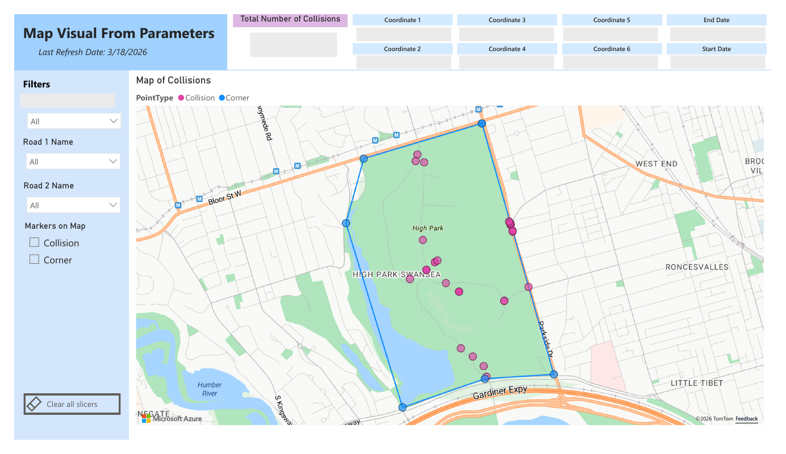
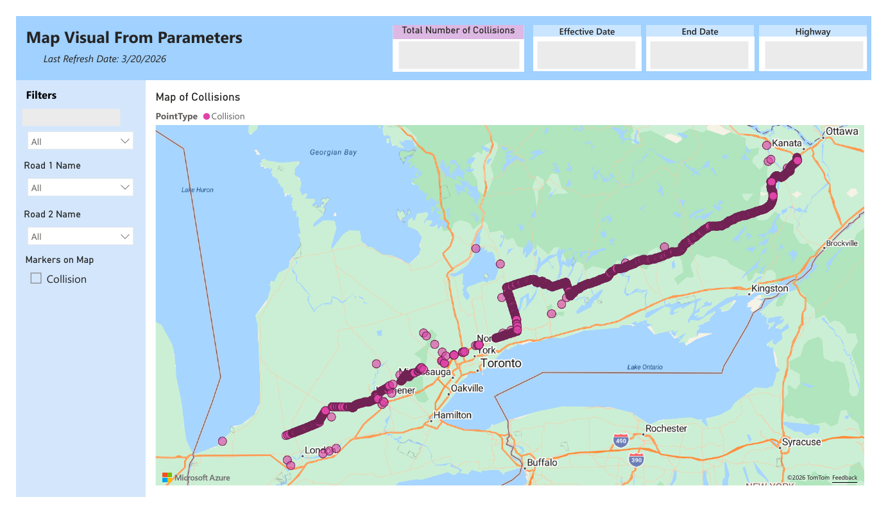
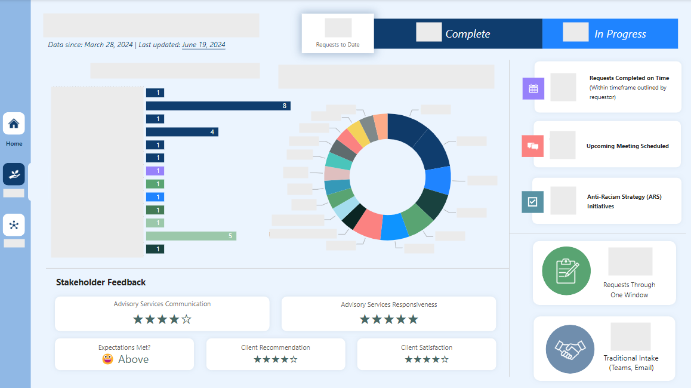
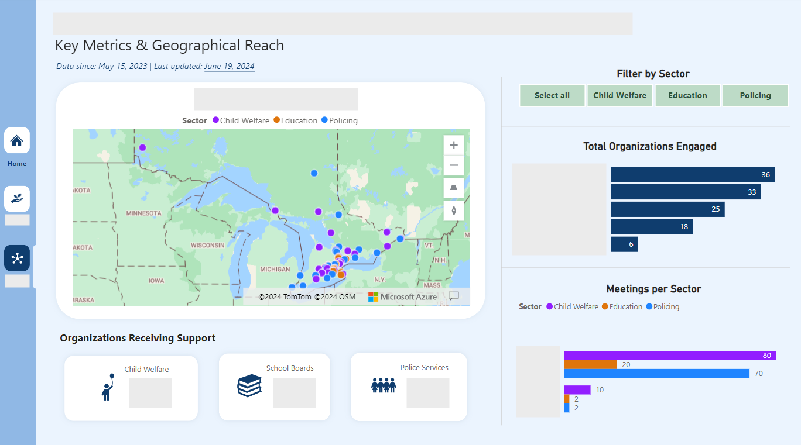
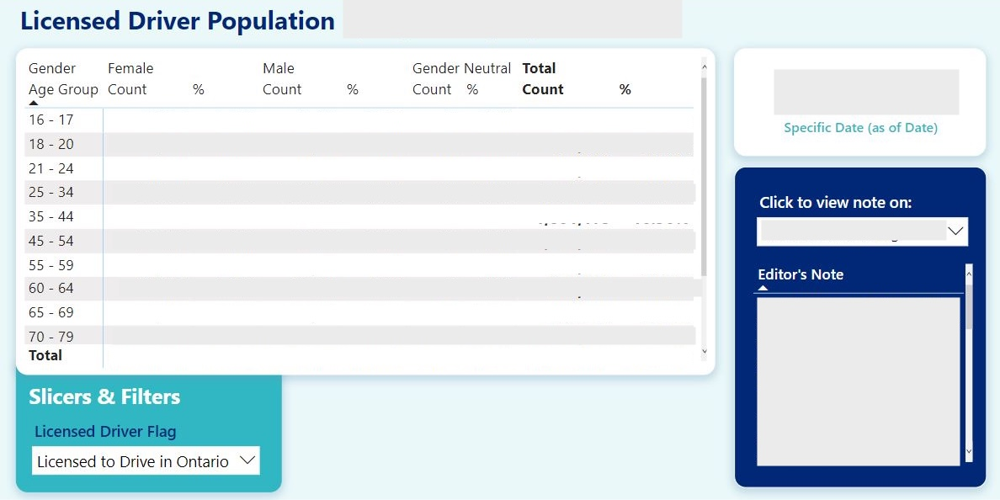

# Power BI Portfolio

A selection of Power BI reports and dashboards I've designed, spanning transportation, public safety, service delivery, and equity-focused analytics. Each project below groups the report pages together, with a short note on what it does and the Power BI features it uses.

> **Note:** This portfolio contains screenshots only. All sensitive data has been redacted, and nothing shown represents real figures or the views of any employer or organization. Samples are included solely to demonstrate my Power BI design skills.

## At a glance

| # | Report | Focus | Pages shown |
|---|--------|-------|:-----------:|
| 1 | [Use of Force Analytics](#1-use-of-force-analytics) | Policing policy insights | 2 |
| 2 | [Police-Reported Hate Crime in Ontario](#2-police-reported-hate-crime-in-ontario) | Policing policy insights | 1 |
| 3 | [Ontario Photo Card (OPC) Renewal](#3-ontario-photo-card-opc-renewal) | Program evaluation | 1 |
| 4 | [Collision in Select Geography](#4-collision-in-select-geography) | Geographic data visualization | 3 variants |
| 5 | [Anti-Racism Directorate Dashboard](#5-anti-racism-directorate-dashboard) | Internal service delivery evaluation | 3 |
| 6 | [Licensed Driver Population](#6-licensed-driver-population) | Descriptive analytics | 1 |

---

## 1. Use of Force Analytics

An executive-level report on police use-of-force reporting, built to help support policy and program development. A summary page leads readers into detailed pages, including a drill-down of individual interactions.

**Highlights**
- **Quick Insights** landing page with narrative summaries and navigation buttons into each detail page
- **"Ask the Data a Question"** natural-language Q&A visual so non-technical users can build their own charts
- **Decomposition tree** that walks from individual actions, to reason for force, to officer responses and de-escalation approaches
- Slicers for race, incident type, and report date range

<table>
  <tr>
    <td width="50%"> Quick Insights</td>
    <td width="50%"> Individual Interaction (decomposition tree)</td>
  </tr>
</table>

---

## 2. Police-Reported Hate Crime in Ontario

A public-facing summary of hate crime trends across Ontario, built from Statistics Canada data tables.

**Highlights**
- Headline callout and KPI card with year-over-year change
- Ranked bar chart of incident rates by census metropolitan area (CMA)
- Table of the largest percentage increases
- Pie chart of incidents by motivation, with year filter buttons and a footnote clarifying data limitations

---

## 3. Ontario Photo Card (OPC) Renewal

Tracks monthly photo card renewals by method (in person vs. online) against a 20% online uptake target.

**Dataset Scale:** 1 million records since 2020

**Highlights**
- KPI cards with sparklines and a target comparison for online volume
- Clustered column chart showing the percentage split by method for every month, with a **20% target reference line**
- Year selector buttons, plus built-in report notes and dataset details (sensitivity, refresh cadence)

---

## 4. Collision in Select Geography

A parameter-driven report template that lets a user pull collision records for a chosen location and date range, then export them. Each template has the same four-page structure (Home, Map, Extract, Data Notes) and differs in how the location is defined.

**Dataset Scale:** 30 million records since 2018

**Variants**
- **Labelled by Highway**: select a highway and date range
- **Point and Radius**: select a latitude, longitude, and radius
- **Complex Polygon**: define a custom area using a list of coordinates (6 in the example shown)

**Highlights**
- Report parameters drive the map, KPIs, and extract tables
- Use AABB (Axis-Aligned Bounding Box) GIS technique to selectively analyze 30M collisions efficiently
- Map visual with collision points plus corner / centre markers for the selected area
- Aggregate and detailed tables designed for CSV export
- Data Notes page documenting field sources and the masking of driver IDs

<table>
  <tr>
    <td width="50%"> Point and Radius</td>
    <td width="50%""> Complex Polygon</td>
  </tr>
  <tr>
    <td width="50%"> Labelled by Highway</td>
  <tr>
</table>

---

## 5. Anti-Racism Directorate Dashboard

A multi-report dashboard with a shared left-hand navigation bar, tracking advisory services requested by ministry partners and outreach to the broader public sector.

**Highlights**
- **Home page** that explains context and contents, with icon navigation to each report
- **Advisory Services** report: request status (complete / in progress), requests by area, requesting organizations, and stakeholder satisfaction shown as star ratings
- **Outreach** report: geographic reach map, organizations engaged, and meetings per sector, filterable by sector
- Consistent colour coding by sector across all pages

<table>
  <tr>
    <td width="50%"> Advisory Services</td>
    <td width="50%"> Broader Public Sector Outreach</td>
  </tr>
</table>

---

## 6. Licensed Driver Population

A tabbed report on Ontario's licensed driver population by age group and gender, with built-in guidance for users.

**Dataset Scale:** Approx. 70 million records

**Highlights**
- Tab-style page navigation across multiple tables
- Matrix with counts and percentages by age group and gender
- Dropdown slicer for the licensed driver flag, as-of date card, and an in-report **editor's note panel** that changes with the selected topic

---

## Tools

Power BI Desktop and Power BI Service
